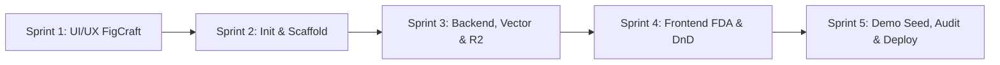

# Roadmap Pengembangan & Pelaksanaan — NextRole

> **Status:** Active / Execution Ready  
> **Versi:** 1.1.0  
> **Dokumen Rujukan:** `docs/PRD.md` (Product Requirements) & `docs/TSD.md` (Technical Specifications)  
> **Repository Target:** `https://github.com/ilsetiawan1/next-role.git`  
> **Arsitektur:** Frontend (Feature-Driven Architecture) • Backend (Modular Layered Repository Pattern)

---

## Ikhtisar Rencana Kerja (Executive Summary)

NextRole adalah platform asisten karir cerdas (*Intelligent Job Hunt Assistant*) yang dirancang untuk mengotomatisasi pencatatan lamaran kerja, menjaga etika follow-up HRD, mengarsipkan persyaratan lowongan kerja (*JD Snapshot*) secara permanen, serta mencocokkan CV terhadap lowongan secara semantik (`Gemini Embedding 2` + `pgvector`) dengan arsip PDF CV aman di Cloudflare R2.

Roadmap ini membagi eksekusi proyek ke dalam **5 Sprint Terukur** dengan pendekatan *API-First*, *Anti-AI Slop UI/UX*, dan *Zero RegEx Policy*:

---

## Sprint 1: Perancangan UI/UX di FigCraft (Canvas Visual) — [SELESAI]

> **Tujuan:** Merancang antarmuka visual high-fidelity di FigCraft yang 100% selaras dengan PRD dan TSD, bebas AI-slop, mengadopsi prinsip ergonomis *Soft Sky Glass*, dan siap dikonversi ke kode.
>
> **Status:** Desain High-Fidelity Lengkap (`Authentication`, `Home`, `Roles`, `Analytics`, `Profile`, `Modal Smart Clipper`, `Modal Catat Lamaran`, `Detail Lamaran`) pada Mobile (390x844), Tablet (834x1194), dan Desktop (1440x900) tersimpan di `docs/next-role.figcraft`.
>
> **[PERINGATAN] Protokol Keselamatan FigCraft:**  
> Pengguna (*User*) **wajib membuka aplikasi FigCraft secara manual terlebih dahulu di `localhost:7979`** sebelum Agent mengirimkan perintah canvas apa pun untuk mencegah crash server localhost.

### Daftar Tiket Sprint 1:

#### Tiket 1.1: Layar Utama Roles / Kanban Board (5 Folder Tanpa Wishlist) & Home Overview
* **Scope & Spesifikasi:**
  * Frame desktop, tablet, dan mobile untuk halaman `Home` & `Roles` (`Papan Lamaran`).
  * **Navigasi Terpadu (4 Menu Utama):** `Home`, `Roles`, `Analytics`, `Profile`, lengkap dengan badge kuota harian `18 / 20 Klip` dan tombol utama `+ Catat Lamaran`.
  * **5 Folder Pipeline Kanban (Sesuai PRD & TSD, tanpa Wishlist):**
    1. `Applied` (Tahap terkirim)
    2. `Follow-Up Needed` (Hari ke-7 tanpa kabar)
    3. `Interview` (Tahap wawancara / `INTERVIEW_SCHEDULED`)
    4. `Offered` (Tahap penawaran)
    5. `Rejected / Ghosted` (Ditolak / Ghosting)
  * **Desain Kartu Lamaran & Persistent Inspector:**
    * Kartu bersih memuat inisial perusahaan, lokasi & tipe kerja, posisi, rentang gaji, tanggal dilamar, dan text button `Detail` tanpa memenuhi ruang kartu dengan badge berlebih.
* **Kriteria Penerimaan (Acceptance Criteria):**
  * Tepat memiliki 5 folder pipeline tanpa `Wishlist`.
  * Desain bersih (*airy*), tidak padat badge warna-warni, kontras teks >= 4.5:1.

---

#### Tiket 1.2: Modal Smart Job Clipper & Input Manual
* **Scope & Spesifikasi:**
  * Modal dialog dengan 2 mode tab: **`Otomatis (AI)`** dan **`Manual`**.
  * **Tab Otomatis (AI):** Area unggah screenshot/PDF lowongan (`PNG, JPG, PDF`) atau tempel link/teks lowongan, status pill kuota harian (`Gemini 3.5 Flash Lite`), serta tombol `Ekstrak dengan AI`.
  * **Tab Manual & Pratinjau Hasil Ekstraksi:** Form terstruktur (Nama Perusahaan, Posisi / Role, Tipe Kerja, Perkiraan Rentang Gaji Opsional, Sumber Lowongan Opsional + Tautan, dan Deskripsi Pekerjaan & Kualifikasi) dengan tombol `Simpan Lamaran`.
* **Kriteria Penerimaan (Acceptance Criteria):**
  * Seluruh field input terpetakan langsung ke skema data tabel `Application` pada TSD.
  * Dilengkapi status kuota harian (`20 klip/hari`) dan catatan otomatis masuk ke kolom `Applied`.

---

#### Tiket 1.3: Detail Inspector / Bottom Sheet (Ringkasan, Arsip JD, Follow-Up H+7, & CV Match Score)
* **Scope & Spesifikasi:**
  * Persistent Inspector Panel di Desktop/Tablet serta Bottom Sheet di Mobile.
  * **Ringkasan & Kontrol Status:** Metadata properti lamaran (gaji, tipe kerja, tanggal dilamar, sumber lamaran, kontak recruiter, lokasi kantor) dan radio selector transisi status (`Applied`, `Interview`, `Offered`, `Rejected`).
  * **Arsip JD Snapshot Permanen & Skor Kecocokan CV:** Area baca teks iklan lowongan asli, daftar `Kualifikasi Kunci Terdeteksi`, dan pill **`Kecocokan CV: XX%`** dari `pgvector`.
  * **Smart Follow-Up Generator:** Indikator H+7 dan generator draf pesan dwi-bahasa (ID/EN) siap salin.
* **Kriteria Penerimaan (Acceptance Criteria):**
  * Memuat seluruh elemen kontekstual tanpa memecah halaman menjadi menu terpisah.
  * Memenuhi kebutuhan calon pelamar saat dihubungi HRD mendadak maupun persiapan interview.

---

#### Tiket 1.4: Halaman Login, Analytics, & Profile (Termasuk Akses CV PDF)
* **Scope & Spesifikasi:**
  * **Authentication:** Opsi Google OAuth dan tombol 1-Click `Explore as Guest (Mode Demo)`.
  * **Analytics:** 6 kartu evaluasi riil (Kecepatan Respon HRD, Konversi Pipeline, Lead Time Tahapan, Preferensi & Gaji, Efektivitas Portal Sumber, Kualifikasi Diminta).
  * **Profile:** Kartu identitas & statistik ringkas + kelompok menu `Account` (Kuota AI Clipper, Akun Google & Keamanan, **Profil CV & Skill (PDF)** dengan tombol preview & ubah), `Preferences`, `Data & Privacy`, serta `Session`.
* **Kriteria Penerimaan (Acceptance Criteria):**
  * Target sentuh mobile >= 44 x 44 px.
  * Visual profesional, konsisten di Desktop, Tablet, dan Mobile.

---

## Sprint 2: Inisialisasi Proyek, Dependensi & Setup Struktur Folder

> **Tujuan:** Menyiapkan fondasi monolit modular Next.js App Router, mengonfigurasi toolchain, Prisma ORM + `pgvector` di Neon, Cloudflare R2 bucket, dan Vercel AI SDK.

### Daftar Tiket Sprint 2:
* **Tiket 2.1: Scaffolding Project Next.js:**
  * Inisialisasi Next.js 15+ (App Router, React 19, TypeScript, ESLint, Tailwind CSS).
  * Instalasi dependensi inti:
    * UI & Icons: `lucide-react`, `clsx`, `tailwind-merge`, `@dnd-kit/core`, `@dnd-kit/sortable`, `@dnd-kit/utilities`.
    * Backend & AI: `@prisma/client`, `prisma`, `ai`, `@ai-sdk/google`, `zod`.
    * Object Storage (Cloudflare R2): `@aws-sdk/client-s3`, `@aws-sdk/s3-request-presigner`.
    * Auth: `next-auth@beta` (Auth.js v5).
    * API Docs: `@scalar/nextjs-api-reference`.
* **Tiket 2.2: Setup Kerangka Folder Standar:**
  * Frontend: Feature-Driven Architecture di `src/features/{auth, clipper, kanban, application-detail, profile, analytics}/`.
  * Backend: Modular Layered Architecture di `src/modules/{auth, profile, job-parser, applications, follow-up}/`.
  * Shared UI & Config: `src/components/ui/`, `src/utils/` (helper tanggal & SHA-256 hash), `src/config/` (`db.ts`, `ai.ts`, `r2.ts`), `src/constants/`, `src/middlewares/`.
* **Tiket 2.3: Konfigurasi Prisma ORM, Neon `pgvector`, & Cloudflare R2:**
  * Buat `prisma/schema.prisma` sesuai skema lengkap di `docs/TSD.md` (termasuk kolom vector `768d` pada `User` & `Application`, serta model `JobParseCache`).
  * Konfigurasi koneksi Neon connection pooling (`DATABASE_URL` port `6543`) dan direct connection (`DIRECT_URL` port `5432`), plus aktivasi ekstensi `vector`.
  * Verifikasi kredensial Private Bucket Cloudflare R2 (`Standard`) pada environment variables server.
* **Tiket 2.4: Sinkronisasi Dokumentasi & Git Setup:**
  * Pastikan `AGENTS.md`, `README.md`, `PRD.md`, `TSD.md`, `DESIGN.md`, dan `ROADMAP.md` sinkron di GitHub (`https://github.com/ilsetiawan1/next-role.git`).

---

## Sprint 3: Backend Core Engine, Vector Search, R2 Storage & Scalar API (API-First)

> **Tujuan:** Mengimplementasikan seluruh backend modular dengan Repository Pattern, migrasi PostgreSQL + `pgvector`, integrasi `Gemini 3.5 Flash Lite` + `Gemini Embedding 2` via Vercel AI SDK, penyimpanan PDF CV di Cloudflare R2, dan dokumentasi API interaktif Scalar.

### Daftar Tiket Sprint 3:
* **Tiket 3.1: Migrasi Database PostgreSQL + `pgvector` (Neon Serverless):**
  * Jalankan migrasi SQL untuk mengaktifkan `CREATE EXTENSION IF NOT EXISTS vector;` dan membuat tabel: `users`, `accounts`, `sessions`, `applications`, `activity_logs`, serta `job_parse_cache`.
  * Verifikasi relasi, indeks performa (`userId`, `status`, `appliedAt`, `deletedAt`, `contentHash`), dan enum `ApplicationStatus`.
* **Tiket 3.2: Modul Autentikasi (`src/modules/auth/`):**
  * Setup Auth.js v5 handler di `src/app/api/auth/[...nextauth]/route.ts`.
  * Dukungan Google OAuth provider dan Mock Guest Session untuk Mode Demo 1-Click.
  * Colocate `auth.routes.ts`, `auth.controller.ts`, `auth.service.ts`, `auth.repository.ts`, `auth.openapi.ts`.
* **Tiket 3.3: Modul Job Parser AI (`src/modules/job-parser/`):**
  * Implementasi cache deduplikasi SHA-256 pada `job-parser.repository.ts` (`JobParseCache`): cache hit tidak memanggil Gemini dan tidak memotong kuota harian.
  * Implementasi ekstraksi cerdas menggunakan `generateObject` dari Vercel AI SDK (`gemini-3.5-flash-lite`) dengan `responseSchema` ketat dan validasi ulang `zod` (retry koreksi mandiri maks 1–2x).
  * Pemrosesan teks tanpa regular expression (**Zero RegEx Policy**).
  * Colocate endpoint `POST /api/v1/parser/extract` dan `job-parser.openapi.ts`.
* **Tiket 3.4: Modul Applications & `pgvector` Match Score (`src/modules/applications/`):**
  * Implementasi Repository Pattern:
    * `findActiveByUserId(userId)` — filter otomatis `deletedAt IS NULL` sekaligus menghitung `matchScore` lokal via `1 - (a.jd_embedding <=> u.cv_embedding)` (0 token AI).
    * `createApplication(data)` — simpan data lamaran, `jdSnapshot`, dan generate 1x `jdEmbedding` (`gemini-embedding-2`, `768d`).
    * `updateStatus(id, status)` — perbarui status kolom Kanban & catat ke `ActivityLog`.
    * `softDelete(id)` — update `deletedAt = new Date()`.
  * Service layer: isolasi otorisasi `userId` dan pencatatan otomatis timeline `ActivityLog`.
  * Colocate `applications.openapi.ts`.
* **Tiket 3.5: Modul Profile CV, Cloudflare R2 & Embedding (`src/modules/profile/`):**
  * `PUT /api/v1/profile/cv`: Validasi file PDF (maks 5 MB), unggah ke Private Bucket Cloudflare R2, hapus objek R2 lama jika ada, ekstrak teks & hitung SHA-256 `cvHash`. Jika `cvHash` berubah, panggil `Gemini Embedding 2` (`768d`) 1x lalu simpan ke `User`.
  * `GET /api/v1/profile/cv/preview`: Verifikasi kepemilikan `session.user.id` lalu terbitkan **Presigned URL** sementara (5 menit) agar PDF CV dapat di-preview dengan aman.
  * `DELETE /api/v1/profile/cv`: Hapus objek R2 dan bersihkan kolom CV user.
  * Colocate `profile.openapi.ts`.
* **Tiket 3.6: Modul Follow-Up Engine (`src/modules/follow-up/`):**
  * Logika kalkulasi status H+7 (lamaran aktif tanpa perubahan status setelah >= 7 hari).
  * Generator draf pesan tindak lanjut sopan (Indonesian & English) berbasis `gemini-3.5-flash-lite`.
  * Colocate endpoint `POST /api/v1/follow-up/generate` dan `follow-up.openapi.ts`.
* **Tiket 3.7: Integrasi Scalar Interactive API Documentation:**
  * Konsolidasi OpenAPI specs dari seluruh modul ke satu registry di `/docs` dan uji validitas seluruh endpoint.

---

## Sprint 4: Frontend Development & Integrasi UI/UX (FDA)

> **Tujuan:** Menerjemahkan rancangan FigCraft menjadi komponen React modular berbasis Feature-Driven Architecture (FDA), mengintegrasikan API backend, dan mengaktifkan interaktivitas drag-and-drop Kanban serta preview PDF CV.

### Daftar Tiket Sprint 4:
* **Tiket 4.1: Atomic Design System (`src/components/ui/`):**
  * Buat komponen atomik (*Soft Sky Glass*): `Button`, `Input`, `Textarea`, `Modal`, `Drawer`, `Badge`, `Card`, `SkeletonLoader`, `Toast`.
* **Tiket 4.2: Fitur Autentikasi & Guest Mode (`src/features/auth/`):**
  * Halaman login responsif dengan tombol Google OAuth dan 1-Click Guest Access + session guard.
* **Tiket 4.3: Fitur Kanban Board Interaktif (`src/features/kanban/`):**
  * Implementasi 5 folder status menggunakan `@dnd-kit` (Drag & Drop ke folder dropzone dan kontrol radio/edit status) dengan *optimistic UI update* dan sinkronisasi ke `PATCH /api/v1/applications/:id/status`.
* **Tiket 4.4: Fitur Smart Job Clipper (`src/features/clipper/`):**
  * Modal 2 tab (`Otomatis (AI)` & `Manual`) terintegrasi dengan `POST /api/v1/parser/extract`, indikator sisa kuota `20 klip/hari`, dan `POST /api/v1/applications`.
* **Tiket 4.5: Fitur Detail Inspector, Arsip JD & Skor Kecocokan (`src/features/application-detail/`):**
  * Panel inspektor / bottom sheet memuat ringkasan, `Kualifikasi Kunci Terdeteksi`, pill **`Kecocokan CV: XX%`**, arsip `jdSnapshot`, dan generator pesan follow-up ID/EN 1-klik salin.
* **Tiket 4.6: Fitur Profile, Upload & Preview PDF CV (`src/features/profile/`):**
  * Implementasi halaman `Profile` (Hero card, statistik, grup Account/Preferences/Data/Session) termasuk modal kelola CV (unggah PDF ke R2 / input teks) dan modal/tab preview PDF via Presigned URL.
* **Tiket 4.7: Fitur Analytics (`src/features/analytics/`):**
  * 6 kartu evaluasi performa karier berbasis data riil (`Application` schema) serta filter pencarian cepat.

---

## Sprint 5: Demo Mode Seeding, Polishing & Deployment Vercel

> **Tujuan:** Menyediakan pengalaman onboarding instan via seed data Mode Demo, melakukan audit keamanan menyeluruh, optimasi performa, dan peluncuran produksi ke Vercel (region Singapore).

### Daftar Tiket Sprint 5:
* **Tiket 5.1: Seeding Data Mode Demo / Guest:**
  * Buat seeder data demo realistis di seluruh 5 folder pipeline (`Applied`, `Follow-Up Needed`, `Interview`, `Offered`, `Rejected / Ghosted`), lengkap dengan `jdSnapshot`, contoh CV & skor `pgvector` siap lihat secara instan.
* **Tiket 5.2: Audit Kualitas & Kepatuhan Aturan Baku:**
  * **Zero RegEx Audit:** Pastikan tidak ada karakter regex `/pattern/` atau `RegExp` di seluruh file frontend dan backend.
  * **Anti-AI Slop Review:** Verifikasi tata letak UI, whitespace 8pt, dan copywriting bebas jargon AI.
  * **Security Audit:** Verifikasi proteksi server-side environment variables (`GEMINI_API_KEY`, `DATABASE_URL`, `DIRECT_URL`, `AUTH_SECRET`, `R2_*`), akses Private Bucket via Presigned URL, sanitasi Zod, dan otorisasi `userId`.
* **Tiket 5.3: Deployment Vercel & Production Verification:**
  * Deploy Next.js di region **Singapore (`sin1`)** sejajar dengan Neon PostgreSQL (`ap-southeast-1`) dan Cloudflare R2 (`Asia Pacific`).
  * Build check zero-error TypeScript dan uji alur end-to-end: Login Guest -> Upload/Preview PDF CV -> Tambah Lamaran via Clipper AI -> Cek Skor Kecocokan `pgvector` -> Geser Kanban -> Generate Pesan Follow-Up.

---

## Matriks Pelacakan Progres (Progress Tracker)

| Sprint | Nama Sprint | Fokus Utama | Target Status |
| :--- | :--- | :--- | :--- |
| **Sprint 1** | Perancangan UI/UX di FigCraft | Canvas Visual (`Home`, `Roles`, `Analytics`, `Profile`, Clipper, Detail, Auth) | Selesai |
| **Sprint 2** | Inisialisasi Proyek & Scaffold | Next.js, FDA, Modular Backend, Prisma `pgvector`, Cloudflare R2 | Antrean |
| **Sprint 3** | Backend Core, Vector & R2 | Neon `pgvector`, Gemini 3.5 Flash Lite, Embedding 2, R2 Presigned, Scalar | Antrean |
| **Sprint 4** | Frontend Development & DnD | Komponen FDA, DnD-Kit, Clipper, Profile CV Preview, Detail Match Pill | Antrean |
| **Sprint 5** | Demo Seed, Audit & Deployment | Guest Seeder, Zero RegEx Audit, Security Audit, Deploy Vercel Singapore | Antrean |
