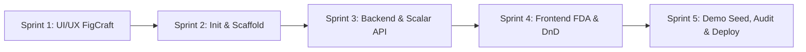

# Roadmap Pengembangan & Pelaksanaan — NextRole

> **Status:** Active / Execution Ready  
> **Versi:** 1.0.0  
> **Dokumen Rujukan:** `docs/PRD.md` (Product Requirements) & `docs/TSD.md` (Technical Specifications)  
> **Repository Target:** `https://github.com/ilsetiawan1/next-role.git`  
> **Arsitektur:** Frontend (Feature-Driven Architecture) • Backend (Modular Layered Repository Pattern)

---

## 🧭 Ikhtisar Rencana Kerja (Executive Summary)

NextRole adalah platform asisten karir cerdas (*Intelligent Job Hunt Assistant*) yang dirancang untuk mengotomatisasi pencatatan lamaran kerja, menjaga etika follow-up HRD, dan mengarsipkan persyaratan lowongan kerja (*JD Snapshot*) secara permanen.

Roadmap ini membagi eksekusi proyek ke dalam **5 Sprint Terukur** dengan pendekatan *API-First*, *Anti-AI Slop UI/UX*, dan *Zero RegEx Policy*:

---

## 🏃 Sprint 1: Perancangan UI/UX di FigCraft (Canvas Visual) — [SELESAI ✅]

> **Tujuan:** Merancang antarmuka visual high-fidelity di FigCraft yang 100% selaras dengan PRD dan TSD, bebas AI-slop, mengadopsi prinsip ergonomis modern, dan siap dikonversi ke kode.
>
> **Status:** 18 Frame High-Fidelity Lengkap (Landing Page, Auth, Home, Lamaran, Kalender, Settings) pada Mobile (390x844), Tablet (834x1194), dan Desktop (1440x900) tersimpan di `docs/next-role.figcraft`.
>
> ⚠️ **Protokol Keselamatan FigCraft:**  
> Pengguna (*User*) **wajib membuka aplikasi FigCraft secara manual terlebih dahulu di `localhost:7979`** sebelum Agent mengirimkan perintah canvas apa pun untuk mencegah crash server localhost.

### Daftar Tiket Sprint 1:

#### 🎫 Tiket 1.1: Layar Utama Kanban Board (6 Kolom Sesuai TSD) & Kartu Metrik Ringkasan
* **Scope & Spesifikasi:**
  * Frame desktop: `Kanban Board - (Desktop 1440x900)`.
  * Frame mobile: `Kanban Board - (Mobile 390x844)`.
  * **Header Navigasi:** Logo "NextRole" (font display berkarakter tegas: *Plus Jakarta Sans* / *Outfit*), badge mode (Demo/Active), tombol "+ Tambah Lamaran", profil pengguna / avatar.
  * **Kartu Metrik Ringkasan (Stats Overview):**
    * Total Lamaran Aktif.
    * Menunggu Follow-Up (H+7).
    * Jadwal Interview Mendatang.
    * Response Rate (%).
  * **6 Kolom Pipeline Kanban (Sesuai enum `ApplicationStatus` di TSD):**
    1. `Wishlist` (Disimpan / Belum Diajukan)
    2. `Applied` (Terkirim)
    3. `Follow-Up Needed` (Hari ke-7 tanpa kabar)
    4. `Interview Scheduled` (Tahap Wawancara)
    5. `Offered` (Menerima Penawaran)
    6. `Rejected / Ghosted` (Ditolak / Presumed Ghosted)
  * **Desain Kartu Lamaran (Application Card):**
    * Nama Posisi (Semi-bold, 14px), Nama Perusahaan (13px, muted), Tag Lokasi/Tipe Kerja (Remote/Hybrid/Full-time).
    * Indikator status minimalis: 1 titik warna 6px di samping teks netral (bebas *pill-soup*).
    * Tanggal lamaran diajukan (e.g., `Diajukan 3 hari lalu`).
    * Indikator peringatan waktu jika sudah mendekati / mencapai H+7.
* **Kriteria Penerimaan (Acceptance Criteria):**
  * Tepat memiliki 6 kolom tanpa penambahan atau pengurangan kolom di luar TSD.
  * Desain bersih (*airy*), tidak padat badge warna-warni, kontras teks $\ge 4.5:1$.

---

#### 🎫 Tiket 1.2: Modal Smart Job Clipper (Input Link & Teks Iklan Lowongan)
* **Scope & Spesifikasi:**
  * Modal dialog dengan latar belakang refraksi halus (*glassmorphism overlay*).
  * **Input Tabs / Toggle Mode:**
    * Tab 1: **"Tempel Teks Lowongan (Raw Text)"** — Textarea lega dengan placeholder panduan, counter karakter, dan tombol aksi "Ekstrak Otomatis via AI".
    * Tab 2: **"Link Lowongan (URL)"** — Input URL lowongan kerja (LinkedIn, Glints, Jobstreet) untuk ekstraksi instan.
  * **Pratinjau Hasil Ekstraksi AI:**
    * Input form hasil ekstraksi terstruktur: Nama Perusahaan, Posisi, Lokasi, Tipe Pekerjaan, Rentang Gaji (opsional), Key Requirements (tags), dan cuplikan JD Snapshot.
    * Tombol aksi: "Simpan ke Pipeline" (Primary CTA) dan "Batal".
* **Kriteria Penerimaan (Acceptance Criteria):**
  * Seluruh field input terpetakan langsung ke skema data tabel `Application` pada TSD.
  * Dilengkapi status visual loading (*AI parsing state*).

---

#### 🎫 Tiket 1.3: Detail Drawer (Tab Ringkasan, Tab Arsip JD Snapshot, Generator Follow-Up)
* **Scope & Spesifikasi:**
  * Slide-over drawer dari sisi kanan (lebar 480px di desktop, full-width di mobile).
  * **Header Drawer:** Nama posisi, nama perusahaan, dropdown transisi status kanban, tombol edit & tombol soft-delete.
  * **Tab 1 — Ringkasan & Riwayat (Overview & Activity Log):**
    * Detail metadata (lokasi, jenis kontrak, rentang gaji, kontak recruiter).
    * Timeline riwayat aktivitas (Applied date, status transitions, follow-up logs).
  * **Tab 2 — Arsip JD Snapshot (Permanent Job Description):**
    * Area baca teks lengkap iklan lowongan asli yang disimpan permanen di database.
    * Bebas dari risiko *ghosted job posting* (bisa dibaca kembali saat persiapan interview).
    * Daftar key requirements yang diekstrak AI.
  * **Tab 3 — Smart Follow-Up Generator:**
    * Status countdown hari sejak lamaran diajukan (H+7 tracker).
    * Generator draf pesan otomatis dengan 2 pilihan bahasa: **Bahasa Indonesia** (formal, sopan) dan **English** (professional, polite).
    * Tombol 1-klik "Salin Draf Pesan" dengan indikator toast tersalin.
* **Kriteria Penerimaan (Acceptance Criteria):**
  * Memuat ketiga tab utama sesuai PRD dan TSD.
  * Memenuhi kebutuhan calon pelamar untuk persiapan interview tanpa kehilangan konteks.

---

#### 🎫 Tiket 1.4: Halaman Login & Tombol 1-Click "Explore as Guest / Mode Demo"
* **Scope & Spesifikasi:**
  * Frame desktop: `Authentication - (Desktop 1440x900)`.
  * Frame mobile: `Authentication - (Mobile 390x844)`.
  * Desain minimalis terpusat (*centered card layout*):
    * Logo NextRole + Tagline "Asisten Cerdas Pelacak & Persiapan Karir".
    * Tombol Utama OAuth: **"Lanjutkan dengan Google"** (Google Icon resmi).
    * Divider pemisah: "atau coba langsung".
    * Tombol 1-Click Akses Cepat: **"Explore as Guest (Mode Demo)"** — akses langsung tanpa pendaftaran akun untuk kemudahan review & portofolio.
    * Footer privasi: Jaminan data terisolasi & aman.
* **Kriteria Penerimaan (Acceptance Criteria):**
  * Target sentuh mobile $\ge 44 \times 44$ px.
  * Visual profesional, tanpa elemen marketing bertele-tele (*no fluff*).

---

## ⚙️ Sprint 2: Inisialisasi Proyek, Dependensi & Setup Struktur Folder

> **Tujuan:** Menyiapkan fondasi monolit modular Next.js App Router, mengonfigurasi toolchain, styling, Prisma ORM, Vercel AI SDK, serta menghubungkan remote repository resmi.

### Daftar Tiket Sprint 2:
* **Tiket 2.1: Scaffolding Project Next.js:**
  * Inisialisasi Next.js 15+ (App Router, React 19, TypeScript, ESLint, Tailwind CSS).
  * Instalasi dependensi inti:
    * UI & Icons: `lucide-react`, `clsx`, `tailwind-merge`, `@dnd-kit/core`, `@dnd-kit/sortable`, `@dnd-kit/utilities`.
    * Backend & AI: `@prisma/client`, `prisma`, `ai`, `@ai-sdk/google`, `zod`.
    * Auth: `next-auth@beta` (Auth.js v5).
    * API Docs: `@scalar/nextjs-api-reference`.
* **Tiket 2.2: Setup Kerangka Folder Standar:**
  * Frontend: Feature-Driven Architecture di `src/features/{auth, clipper, kanban, application-detail, analytics}/`.
  * Backend: Modular Layered Architecture di `src/modules/{auth, job-parser, applications, follow-up}/`.
  * Shared UI: `src/components/ui/` dan utilitas bersama di `src/utils/`, `src/config/`, `src/constants/`, `src/middlewares/`.
* **Tiket 2.3: Konfigurasi Prisma ORM & Database Neon:**
  * Buat `prisma/schema.prisma` sesuai skema database lengkap di `docs/TSD.md`.
  * Konfigurasi koneksi Neon connection pooling (`DATABASE_URL`) dan direct connection (`DIRECT_URL`).
  * Inisialisasi Prisma Client singleton di `src/config/db.ts`.
* **Tiket 2.4: Sinkronisasi Dokumentasi & Git Setup:**
  * Update `AGENTS.md` dan `README.md` dengan identitas NextRole.
  * Hubungkan git remote ke `https://github.com/ilsetiawan1/next-role.git`.
  * First commit dan push ke branch `main`.

---

## 🔌 Sprint 3: Backend Core Engine & Dokumentasi API Scalar (API-First)

> **Tujuan:** Mengimplementasikan seluruh backend modular dengan Repository Pattern, migrasi skema database PostgreSQL, integrasi Gemini 1.5 Flash via Vercel AI SDK, dan dokumentasi API interaktif menggunakan Scalar.

### Daftar Tiket Sprint 3:
* **Tiket 3.1: Migrasi Database PostgreSQL (Neon Serverless):**
  * Jalankan `prisma migrate dev` / `prisma db push` untuk membuat tabel: `users`, `accounts`, `sessions`, `applications`, `activity_logs`.
  * Verifikasi relasi, indeks performa (`userId`, `status`, `appliedAt`, `deletedAt`), dan enum `ApplicationStatus`.
* **Tiket 3.2: Modul Autentikasi (`src/modules/auth/`):**
  * Setup Auth.js v5 handler di `src/app/api/auth/[...nextauth]/route.ts`.
  * Dukungan Google OAuth provider dan Mock Guest Session untuk Mode Demo 1-Click.
  * Colocate `auth.routes.ts`, `auth.controller.ts`, `auth.service.ts`, `auth.repository.ts`, `auth.openapi.ts`.
* **Tiket 3.3: Modul Job Parser AI (`src/modules/job-parser/`):**
  * Implementasi service ekstraksi cerdas menggunakan `generateObject` dari Vercel AI SDK (`gemini-1.5-flash`).
  * Validasi skema output menggunakan `zod` (Company, Position, Location, EmploymentType, SalaryRange, KeyRequirements, JdSnapshot).
  * Pemrosesan teks tanpa regular expression (**Zero RegEx Policy**).
  * Colocate endpoint `POST /api/v1/parser/extract` dan dokumentasi `job-parser.openapi.ts`.
* **Tiket 3.4: Modul Applications (`src/modules/applications/`):**
  * Implementasi Repository Pattern:
    * `findActiveByUserId(userId)` — filter otomatis `deletedAt IS NULL`.
    * `createApplication(data)` — simpan data lamaran + arsip permanen `jdSnapshot`.
    * `updateStatus(id, status)` — perbarui status kolom Kanban & catat ke `ActivityLog`.
    * `softDelete(id)` — update `deletedAt = new Date()`.
  * Service layer: isolasi otorisasi user ID dan pencatatan otomatis timeline `ActivityLog`.
  * Controller & Routes: `GET`, `POST`, `PATCH /:id/status`, `DELETE /:id`.
  * Colocate `applications.openapi.ts`.
* **Tiket 3.5: Modul Follow-Up Engine (`src/modules/follow-up/`):**
  * Logika kalkulasi status H+7 (lamaran aktif tanpa perubahan status setelah $\ge 7$ hari).
  * Generator draf pesan tindak lanjut sopan (Indonesian & English) berbasis nama perusahaan, posisi, dan tanggal kirim.
  * Colocate endpoint `POST /api/v1/follow-up/generate` dan `follow-up.openapi.ts`.
* **Tiket 3.6: Integrasi Scalar Interactive API Documentation:**
  * Konsolidasi OpenAPI specs dari seluruh modul ke satu registry.
  * Expose endpoint viewer Scalar di `/docs` (dokumentasi API interaktif tanpa konfigurasi rumit).
  * Uji validitas seluruh endpoint API melalui runner Scalar.

---

## 🎨 Sprint 4: Frontend Development & Integrasi UI/UX (FDA)

> **Tujuan:** Menerjemahkan rancangan FigCraft menjadi komponen React modular berbasis Feature-Driven Architecture (FDA), mengintegrasikan API backend, dan mengaktifkan interaktivitas drag-and-drop Kanban.

### Daftar Tiket Sprint 4:
* **Tiket 4.1: Atomic Design System (`src/components/ui/`):**
  * Buat komponen atomik: `Button`, `Input`, `Textarea`, `Modal`, `Drawer`, `Badge`, `Card`, `SkeletonLoader`, `Toast`.
  * Terapkan tema warna netral, tipografi berkarakter (*Plus Jakarta Sans* / *Inter*), dan styling bebas *pill-soup*.
* **Tiket 4.2: Fitur Autentikasi & Guest Mode (`src/features/auth/`):**
  * Halaman login responsif dengan tombol Google OAuth dan 1-Click Guest Access.
  * Session context & auth guard middleware untuk proteksi rute dashboard.
* **Tiket 4.3: Fitur Kanban Board Interaktif (`src/features/kanban/`):**
  * Implementasi 6 kolom status menggunakan `@dnd-kit`.
  * Drag-and-drop mulus antar kolom dengan pembaruan instan (*optimistic UI update*) dan sinkronisasi ke `PATCH /api/v1/applications/:id/status`.
  * Rendering kartu lamaran lengkap dengan indikator dot 6px dan peringatan H+7.
* **Tiket 4.4: Fitur Smart Job Clipper (`src/features/clipper/`):**
  * Modal dialog penginput teks lowongan/link.
  * Integrasi pemanggilan API `POST /api/v1/parser/extract` dengan visual shimmer loading state.
  * Form konfirmasi data hasil parsing sebelum disimpan ke Kanban board.
* **Tiket 4.5: Fitur Detail Drawer & Arsip JD (`src/features/application-detail/`):**
  * Komponen drawer geser dengan 3 tab: Ringkasan, Arsip JD Snapshot, dan Follow-Up Generator.
  * Tampilan JD Snapshot yang nyaman dibaca dengan tombol salin teks.
  * Generator pesan follow-up dengan opsi bahasa (ID/EN) dan tombol 1-klik "Copy to Clipboard".
* **Tiket 4.6: Fitur Analytics & Header (`src/features/analytics/`):**
  * Komponen metrik ringkasan (Total Applied, Follow-up Pending, Interview, Response Rate).
  * Filter pencarian cepat berdasarkan nama perusahaan atau posisi.

---

## 🚀 Sprint 5: Demo Mode Seeding, Polishing & Deployment Vercel

> **Tujuan:** Menyediakan pengalaman onboarding instan via seed data Mode Demo, melakukan audit keamanan menyeluruh, optimasi performa, dan peluncuran produksi ke Vercel.

### Daftar Tiket Sprint 5:
* **Tiket 5.1: Seeding Data Mode Demo / Guest:**
  * Buat seeder data demo realistis berisi 6 kartu lamaran di berbagai tahapan pipeline (Wishlist, Applied, Follow-up Needed H+7, Interview, Offered, Ghosted).
  * Sertakan arsip *JD Snapshot* nyata dan riwayat aktivitas agar evaluator atau pengguna baru langsung dapat merasakan nilai produk secara instan.
* **Tiket 5.2: Audit Kualitas & Kepatuhan Aturan Baku:**
  * **Zero RegEx Audit:** Pastikan tidak ada karakter regex `/pattern/` atau `RegExp` di seluruh file frontend dan backend.
  * **Anti-AI Slop Review:** Verifikasi tata letak UI, whitespace 8pt, dan copywriting bebas jargon AI.
  * **Security Audit:** Verifikasi proteksi server-side environment variables (`GEMINI_API_KEY`, `DATABASE_URL`, `AUTH_SECRET`), sanitasi payload, dan otorisasi user ID.
* **Tiket 5.3: Deployment Vercel & Production Verification:**
  * Konfigurasi environment variables di dashboard Vercel.
  * Build check dan validasi zero-error TypeScript.
  * Uji alur end-to-end: Login Guest $\rightarrow$ Tambah Lamaran via Clipper AI $\rightarrow$ Geser Kanban $\rightarrow$ Buka JD Snapshot $\rightarrow$ Generate Pesan Follow-Up.

---

## 📊 Matriks Pelacakan Progres (Progress Tracker)

| Sprint | Nama Sprint | Fokus Utama | Target Status |
| :--- | :--- | :--- | :--- |
| **Sprint 1** | Perancangan UI/UX di FigCraft | Canvas Visual (Kanban, Clipper, Drawer, Auth) | ⏳ Siap Dijalankan |
| **Sprint 2** | Inisialisasi Proyek & Scaffold | Next.js, FDA, Modular Backend, Prisma, GitHub | ⚪ Antrean |
| **Sprint 3** | Backend Core & Scalar API | PostgreSQL Neon, Gemini AI, Soft Delete, Scalar | ⚪ Antrean |
| **Sprint 4** | Frontend Development & DnD | Komponen FDA, DnD-Kit, Clipper, Drawer | ⚪ Antrean |
| **Sprint 5** | Demo Seed, Audit & Deployment | Guest Seeder, Zero RegEx Audit, Deploy Vercel | ⚪ Antrean |

